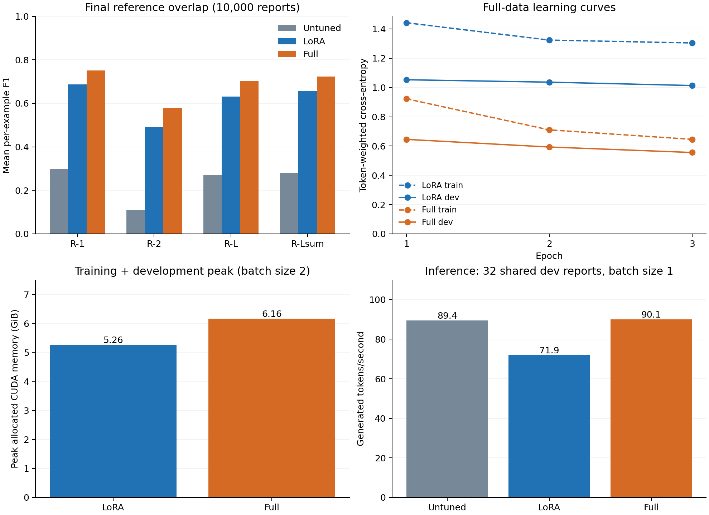

# Plain-Language Radiology Reports: FLAN-T5 with LoRA and Full Fine-Tuning

**Adin Sreekesh — s4969031 | COMP3710 | Hard difficulty**

> Working report outline. Verified measurements have been inserted; writing
> prompts and submission checks remain. Remove prompts only after completing
> and reviewing the corresponding sections.

## Problem and intended use

<!-- WRITE: One paragraph explaining the reader's need, the report-to-explanation
task, and why a clinical reviewer rather than a patient directly uses the draft.
State the engineering dilemma: reference overlap can improve while summaries
invent findings, omit information, or alter certainty. -->

## How the approach works

<!-- WRITE: One paragraph explaining encoder/decoder roles, the instructed input,
the reference target, and how full fine-tuning differs from LoRA. Explain why
FLAN-T5-small was feasible; do not claim it beats GPT-2, which was not tested. -->



Figure 1. Measured results from the full-data experiments. ROUGE uses 10,000
reserved evaluation reports; inference throughput uses 32 shared development
reports on an A100, with float32 and batch size one. Training memory is the
maximum recorded epoch peak at batch size two. These are different workloads.
Training curves were transcribed from the supplied Rangpur epoch logs; see
[measurement provenance](report_data/training_measurements.json).

## Feasibility review

<!-- INSERT: Your reviewed one-page feasibility review here. The local file
FEASABILITY_REVIEW.md currently contains only identification details, not the
complete review discussed in chat. Include acceptance criteria, model/course
concepts, preliminary evidence, risks, resource budget, and fallback. Preserve
the chronology: early subset results belong to preliminary evidence. -->

**Tutor check-off:** completion/date not yet recorded in this repository.
<!-- UPDATE only from actual consultation evidence. The written review alone
does not establish completion of the compulsory practical hurdle. -->

## Data and preprocessing

Dataset: [BioLaySumm2025 LaymanRRG open-source track](https://huggingface.co/datasets/BioLaySumm/BioLaySumm2025-LaymanRRG-opensource-track).

| Data stage | Rows | Role |
|---|---:|---|
| Original training | 150,454 | Source for training/development preparation |
| Training after identifier-overlap filtering | 150,316 | Remove 138 rows sharing final-evaluation identifiers |
| Prepared training | 142,801 | Weight updates |
| Prepared development | 7,515 | Tuning and checkpoint selection |
| Supplied validation | 10,000 | Reserved final scored evaluation |
| Supplied test | 10,537 | Reference summaries blank; not used for ROUGE |

<!-- WRITE: Explain source-qualified identifiers, parsing OpenI's path lists,
connected-record grouping, 5% of groups for development, and seed 42. Explain why
all rows sharing an identifier must remain together. -->

<!-- WRITE: Describe the actual processing: complete source/target tokenisation,
instruction from config.py, dynamic padding, -100 target padding, no input or
target truncation. Distinguish this from the 1,024-token generation cap. -->

**Scope of leakage checks:** zero individual image/session identifier overlap
was verified between prepared training and development and between filtered
training data and reserved evaluation. **Patient-level separation is unverified.**
Repeated report wording is retained. These results do not establish performance
on verified unseen patients.

See [data audit](DATA_AUDIT.md) for repeated texts, missing values and split counts.
The Rangpur logs identify dataset revision
`6783ab38f9de28c4372799346f51d3927ae7eb9a`.
<!-- REPRODUCIBILITY LIMIT: The current loader requests the default dataset
revision rather than pinning it. Document model revision and dependency
snapshots; do not imply that all historical runs were revision-pinned. -->

## Models and training procedure

| Setting | Untuned baseline | LoRA | Full fine-tuning |
|---|---|---|---|
| Base checkpoint | google/flan-t5-small | Same | Same |
| Total parameters | 76,961,152 | 77,305,216 | 76,961,152 |
| Parameters updated in adaptation | None | 344,064 | 76,961,152 |
| Learning rate | Not applicable | 0.001 | 0.0001 |
| Optimiser | Not applicable | AdamW | AdamW |
| Training epochs | None | 3 | 3 |
| Training batch size | Not applicable | 2 | 2 |
| Selected epoch | Not applicable | 3 | 3 |

LoRA configuration: query/value projections (`q`, `v`), rank 8, alpha 16,
dropout 0.05, and no additional trainable biases. Adapters remain unmerged
for evaluation and profiling.

<!-- WRITE: Explain teacher forcing, cross-entropy ignoring padded labels,
gradient clipping at norm 1.0, and token-weighted epoch loss. Describe best-model
selection by development loss and separate latest-state recovery checkpoints.
State the 500-update recovery interval and fixed epoch shuffle seed. -->

<!-- WRITE: Summarise the 128-example pilots and 10,000-example development runs.
Acknowledge different learning rates, unequal pilot tuning, one training seed,
and the absence of an exhaustive hyperparameter comparison. -->

## Evaluation procedure

<!-- WRITE: Distinguish development loss (reference-guided prediction) from
independent generation. Explain mean per-example ROUGE F1 and why ROUGE cannot
verify clinical facts. State stemming and sentence boundaries for ROUGE-Lsum. -->

Final decoding uses the shared instruction, full inputs, greedy generation
(`do_sample=False`, `num_beams=1`), `max_new_tokens=1024`,
`min_new_tokens=0`, `repetition_penalty=1.0`, and `no_repeat_ngram_size=0`.
All models use identical evaluation examples and order. Final findings were
used for reporting, not additional tuning.

See the [evaluation plan](FINAL_EVALUATION_PLAN.md). It records the pre-evaluation
plan; its original future-tense status has not been rewritten as historical evidence.

## Final quantitative results

| Mean F1 | Untuned | LoRA | Full |
|---|---:|---:|---:|
| ROUGE-1 | 0.2989 | 0.6862 | 0.7504 |
| ROUGE-2 | 0.1102 | 0.4905 | 0.5791 |
| ROUGE-L | 0.2705 | 0.6304 | 0.7041 |
| ROUGE-Lsum | 0.2796 | 0.6552 | 0.7229 |

| Source | Count | Untuned R-Lsum | LoRA R-Lsum | Full R-Lsum |
|---|---:|---:|---:|---:|
| BIMCV-COVID19 | 2,042 | 0.2564 | 0.5802 | 0.6720 |
| OpenI | 134 | 0.2182 | 0.6528 | 0.7396 |
| PadChest | 7,824 | 0.2868 | 0.6749 | 0.7359 |

| Generation diagnostic | Untuned | LoRA | Full |
|---|---:|---:|---:|
| Mean generated tokens | 39.14 | 57.77 | 53.46 |
| Cap reached without EOS | 87 / 10,000 | 118 / 10,000 | 36 / 10,000 |
| Cap-hit percentage | 0.87% | 1.18% | 0.36% |

<!-- WRITE: Interpret improvements, source differences, small OpenI count,
PadChest's dominance, and cap-hit findings. Do not call ROUGE medical accuracy
or treat EOS as evidence of factual correctness. Avoid significance claims:
confidence intervals and repeated training runs have not been computed. -->

## Resource comparison

| Training measurement | LoRA | Full |
|---|---:|---:|
| Total job runtime | 6 h 19 min 8 s | 7 h 51 min 58 s |
| Best development loss | 1.0136 | 0.5561 |
| Maximum recorded allocated CUDA memory | 5.26 GiB | 6.16 GiB |

Job times include setup, development evaluation and checkpoint writes. Memory
peaks cover each epoch's training and development window, not total device VRAM.
The baseline has no adaptation training cost.

| Inference measurement | Untuned | LoRA | Full |
|---|---:|---:|---:|
| Generated tokens/s | 89.41 | 71.93 | 90.11 |
| Mean latency/report (s) | 0.603 | 0.388 | 0.349 |
| Median latency/report (s) | 0.184 | 0.256 | 0.244 |
| Peak allocated CUDA memory (GiB) | 0.325 | 0.301 | 0.300 |

<!-- WRITE: Weigh quality against adaptation cost. Explain unmerged-adapter
overhead, variable output lengths, the baseline's one cap hit in the 32-report
profile, and why this is not a repeated fixed-length speed benchmark. -->

See [inference measurement details](INFERENCE_PROFILE_SUMMARY.md). Timing excludes
loading, tokenisation, transfers, decoding, warm-up and scoring. Hardware was an
A100-PCIE-40GB; model precision was float32.

## Failure autopsies and reference quality

<!-- WRITE: Briefly distinguish the two final selection procedures: five low-
overlap candidates and four cap-hit failures. They are biased case samples,
not estimates of population error rates or expert clinical validation. -->

| Final subset index | Source | Evidence to discuss |
|---|---|---|
| 246 | BIMCV-COVID19 | Invented diagnosis, omitted addendum, repetitive full output |
| 674 | PadChest | Both models invent findings from a label-only input |
| 8357 | OpenI | Full repeats placeholders; LoRA contradicts fluid findings |
| 2431 | BIMCV-COVID19 | Anatomical substitutions, repetition, unfinished long output |

<!-- WRITE: For EACH case, explain input difficulty, baseline vs LoRA vs full,
observed errors, source evidence, uncertainty about the cause, and practical
consequences. Use FINAL_CASE_REVIEW.md as working notes, not an unquestioned
clinical authority. Confirm permission before reproducing source excerpts. -->

<!-- WRITE: Discuss counterexamples: 1152 is a faithful low-overlap paraphrase;
8820 has a contradictory target; 2721 retains jargon; 2958 has a Chinese target.
Explain why no final records were silently removed after reviewing results. -->

Working analyses: [final cases](FINAL_CASE_REVIEW.md) and
[development cases](DEVELOPMENT_CASE_REVIEW.md).

## Engineering recommendation and limitations

<!-- YOUR CONCLUSION: Which method would you advance, for what narrowly defined
use, and why? Balance final overlap, factual failures, training cost, inference
measurements, and the cost of human review. -->

<!-- EXPLAIN: Any proposed placeholder, repetition, entity/side, uncertainty or
cap checks have NOT been implemented/validated. Distinguish proposals from
tested features. Do not recommend autonomous patient-facing deployment based
on these results. Explain the need for expert and patient-readability studies. -->

<!-- LIMITATIONS: unverified patients, repeated texts, faulty/mixed-language
targets, single seed, unequal tuning, small inference sample, no confidence
intervals, and limited student clinical expertise. -->

## Running and reproducing the project

Run commands from this project directory. Python 3.11.15 was used locally and
on Rangpur. Mac dependencies are recorded in [requirements-local.txt](requirements-local.txt).

<!-- ACTION: Download and include requirements-rangpur.txt from the remote
project. Do not use the Mac torch pin as the CUDA environment specification.
Record exact model revision and tested reporting dependency versions too. -->

| File | Responsibility |
|---|---|
| modules.py | FLAN-T5 wrapper, LoRA construction, adapter-aware loading |
| dataset.py | Loading, identifier filtering/grouping, splits, tokenisation |
| train.py | Training, development loss, selection, recovery and resource logs |
| evaluate.py | Development/final generation, recovery, ROUGE and diagnostics |
| predict.py | Currently the original tiny-overfit prediction demonstration |
| profile_inference.py | Shared-development inference benchmark |
| plot_results.py | Render figure from downloaded measurements |

**Prediction interface still needs updating:** `predict.py` currently loads
`tiny_overfit`, uses training examples and lacks CUDA selection. It is not yet
the final trained-checkpoint prediction interface. Do not describe it as such.

Representative full-data training command (inside an allocated GPU job):

```bash
python train.py --mode lora --learning-rate 0.001 --train-size 142801 \
  --dev-size 7515 --batch-size 2 --epochs 3 --save-every 500 --run-name lora_all
```

For full fine-tuning use `--mode full --learning-rate 0.0001 --run-name full_all`.
To continue an interrupted run, repeat its settings and add `--resume`.
Use a new run name for a fresh experiment; do not overwrite trained checkpoints.

Representative final evaluation command (already executed; not a tuning step):

```bash
python evaluate.py --checkpoint lora_all --split final --samples 10000 \
  --max-new-tokens 1024 --output-name lora_all_final_eval
```

For full evaluation change checkpoint/output names to `full_all` and
`full_all_final_eval`. Add `--resume` only to continue compatible saved progress.
Do not modify checkpoints between evaluation sessions. Existing results folders
are protected against accidental fresh-run overwrites.

Slurm scripts include account `comp3710`, partition `comp3710`, and one GPU.
The course QoS limit observed was 12 hours. Installs/data setup use CPU sessions;
training/inference use GPU batch jobs. NLTK requires English `punkt_tab` resources;
the remote copy was transferred from the local installation after its downloader
refused a proxied request. No security bypass was used.

Datasets, model weights, environments, and raw prediction files are excluded
from Git. Weights must be produced using the documented training procedure;
they are not supplied in this repository.

<!-- ACTION: Document how to regenerate the plot with Matplotlib installed,
how to obtain authorised data/model files, and clean-environment checks. -->

## Artificial Intelligence Usage Disclosure

<!-- WRITE IN YOUR OWN WORDS: Identify Codex/ChatGPT assistance with planning,
Python and Slurm code, debugging, audit suggestions, case-review drafts,
profiling, figures, and this outline/tables. Identify what you actually wrote
or reviewed yourself. -->

<!-- STATE VERIFICATION PRECISELY: Local and cluster smoke tests, tiny overfit,
save/reload, interrupted training recovery, simulated evaluation recovery,
split checks, and measured runs. Some recent changes received only syntax or
mock tests; do not say every line was independently clinically validated.
Explain your remaining review and responsibility without overstating it. -->

## References

- Raffel et al. (2020). [Exploring the Limits of Transfer Learning with a Unified Text-to-Text Transformer](https://www.jmlr.org/papers/v21/20-074.html).
- Chung et al. (2022 preprint). [Scaling Instruction-Finetuned Language Models](https://arxiv.org/abs/2210.11416).
- Hu et al. (2021 preprint). [LoRA: Low-Rank Adaptation of Large Language Models](https://arxiv.org/abs/2106.09685).
- [FLAN-T5-small checkpoint](https://huggingface.co/google/flan-t5-small).
- [Hugging Face PEFT documentation](https://huggingface.co/docs/peft/en/quicktour).
- [LaymanRRG open-source dataset](https://huggingface.co/datasets/BioLaySumm/BioLaySumm2025-LaymanRRG-opensource-track).

<!-- ADD: Formal dataset/shared-task and ROUGE citations after reading the
relevant sources. Cite adapted library patterns in code docstrings as well. -->

## Submission checklist (remove or complete before submission)

- [ ] Write/review all author sections and remove unfinished prompts.
- [ ] Insert the complete feasibility review and verify tutor check-off status.
- [ ] Update and verify the real trained-model prediction interface.
- [ ] Include cluster dependency snapshot and document revision limitations.
- [ ] Verify training transcription against downloaded raw cluster logs.
- [ ] Review clinical interpretations and permissions for example excerpts.
- [ ] Complete AI disclosure and citations honestly.
- [ ] Check figure rendering, links, commands, and README PDF export.
- [ ] Check Git excludes data/weights and has meaningful progressive commits.
- [ ] Submit working PR to upstream topic-recognition and README PDF to Turnitin.
- [ ] Respond to later teaching-team review within the published window.
