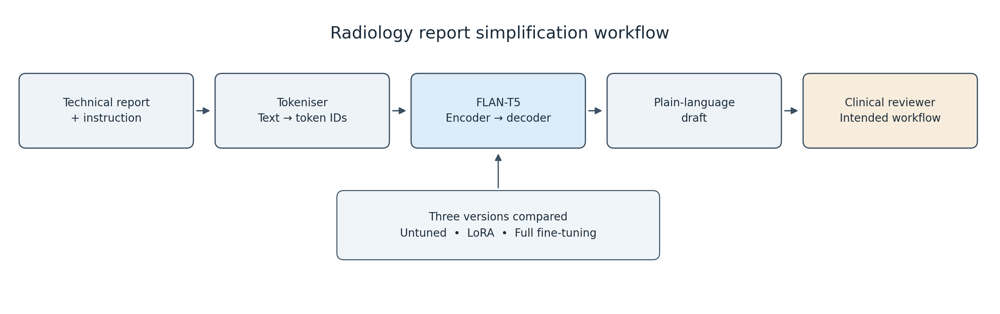

# Simplifying Radiology Reports with FLAN-T5: LoRA vs Full Fine-Tuning

**Adin Sreekesh — s4969031 | COMP3710 | Hard difficulty**

## Problem and intended use

Radiology reports often contain medical terms and abbreviations that patients
may find difficult to understand. This project uses FLAN-T5-small to turn these
reports into plain-language explanations for a clinical reviewer to check before
sharing with patients. The aim is to make the wording clearer while preserving
findings, negative statements and uncertainty. This matters because a fluent
explanation can still invent information, omit an important detail or present a
possible finding as confirmed. The project compares the original pretrained
model with LoRA and full fine-tuning to investigate how adaptation affects
summary quality and computing cost.

## How the approach works

The system combines a technical report with an instruction to simplify it, and
converts that text into numerical token IDs using a tokeniser. FLAN-T5's encoder
processes the input, while the decoder generates an explanation one token at a
time. During training, the model learns from paired technical reports and
plain-language references by adjusting its trainable weights to reduce
prediction errors. Full fine-tuning updates all the model weights, while LoRA
freezes the original weights and trains a small set of added low-rank matrices.
The models are evaluated on the same reports using ROUGE scores, manual checks
of factual faithfulness and readability, and measurements of training time,
generation speed and GPU memory usage.



**Figure 1.** Radiology report simplification workflow. The report and instruction
are tokenised and processed by FLAN-T5 to generate a plain-language draft. The
project compares untuned, LoRA-adapted and fully fine-tuned versions. Clinical
review is the intended workflow; it was not tested with clinicians or patients.

## Feasibility review

Completed and discussed with the tutor at the compulsory check-off on
**23 October 2026**.

### User need, scope and acceptance criteria

This project aims to help clinical reviewers explain radiology reports to
patients. The prototype will produce plain-language drafts for a reviewer to
check before use. The main question is whether fine-tuning makes these
explanations clearer without introducing incorrect findings, leaving out
important details, or changing the report's uncertainty.

I will consider the prototype successful if it:

1. Improves all four required ROUGE metrics over the baseline model.
2. In five audited cases, the selected model does not introduce any unsupported
   findings and preserves negation and uncertainty (suspected illness versus
   confirmed illness).
3. In those cases, all the important findings are preserved and medical terms
   are explained in simple language. Any remaining problems are documented.
4. Trains within one A100's 40 GB GPU memory in under 12 hours, with memory use,
   training time and generation speed reported.
5. Reloads saved weights and generates summaries through a documented
   prediction script.

### Model choice and course concepts

I will compare untuned FLAN-T5-small with LoRA and full fine-tuning using the
BioLaySumm 2025 LaymanRRG dataset. FLAN-T5 reads the report and an instruction,
then generates an explanation. LoRA trains a small set of added weights, while
full fine-tuning updates the whole model. I chose FLAN-T5 because its
encoder–decoder structure suits report-to-summary generation. GPT-2 is
decoder-only and would require a different input format and training-loss
setup. FLAN-T5-small also makes local development and small training experiments
feasible on my Mac.

The project applies several course concepts. Embeddings turn text tokens into
numerical representations, while attention helps the model use context from
across the report when generating an explanation. During training,
cross-entropy loss measures how well its predictions match the reference
summary and guides weight updates.

### Preliminary feasibility evidence

The data audit removed 138 training rows that shared image/session identifiers
with validation rows. Grouped splitting produced 142,801 training and 7,515
development examples without shared individual identifiers. Patient-level
separation remains unverified, as different reports may refer to the same
patient. Since the supplied test summaries are blank, I have reserved the
supplied validation set for final evaluation.

Training, prediction, checkpoint loading and interrupted-run recovery have
worked. Three-epoch trials using 10,000 training and 1,000 development examples
produced:

| Measurement | Baseline | LoRA | Full |
|---|---|---:|---:|
| Development ROUGE-Lsum | 0.285 | 0.622 | 0.678 |
| Final-epoch training time | Not applicable—no adaptation training | 526 s | 675 s |
| Final-epoch peak allocated GPU memory | Not measured during training | 4.21 GiB | 5.04 GiB |

These results support technical feasibility and improved reference overlap, but
do not necessarily establish medical accuracy. The methods used different
learning rates and received unequal tuning effort. Increasing LoRA's learning
rate from 0.0001 to 0.001 improved its development results.

### Risks, budget and fallback

The main risks include incorrect or missing findings, unclear wording,
imperfect reference summaries and outputs being cut short. Repeated reports and
unverified patient separation also limit what the results can establish.

The 10,000-example trials used one A100 with a three-hour allocation per
training job. Full-data runs request up to 12 hours each, with regular recovery
checkpoints and separate evaluation jobs.

The next planned experiment is to compare both methods on the full prepared
training set, using development loss to select checkpoints.

If resources become limited, I will retain FLAN-T5-small and the documented
training subset. If important factual errors remain, I will recommend further
development and mandatory human review.

## Example inputs and outputs

The following development example shows how the models rewrite a technical
report. The baseline largely repeats the original wording, while both
fine-tuned models replace medical terms with simpler language. This example
illustrates a successful output, but it does not establish reliability across
other reports.

| Version | Text |
|---|---|
| Input report | The endotracheal tube is well positioned. The pulmonary parenchyma shows no significant abnormalities. |
| Reference explanation | The breathing tube is in the right place. The lung tissue looks normal with no major issues. |
| Untuned baseline | The endotracheal tube is well positioned. The pulmonary parenchyma shows no significant abnormalities. |
| LoRA | The breathing tube is in the right place. The lung tissue looks normal with no major issues. |
| Full fine-tuning | The breathing tube is in the right place. The lung tissue looks normal with no major issues. |

**Table 1.** Development example 25 from PadChest, generated by models trained
on 10,000 examples. This illustrates a successful output and is not a
final-evaluation result.

Both adapted models explain “endotracheal tube” as “breathing tube” and
“pulmonary parenchyma” as “lung tissue,” while retaining the report's main
findings. However, other examples contain repetition, omissions and unsupported
statements. These failures are examined separately in the error-analysis section.

### Visual summary of results


**Figure 2.** Final ROUGE scores, full-data learning curves, training memory and
inference throughput. ROUGE uses 10,000 reserved evaluation reports, while
inference profiling uses 32 shared development reports.

Figure 2 summarises the quality and computing-cost comparisons. Full fine-tuning
achieved higher final ROUGE scores than LoRA, but required more training time
and memory. The detailed results and their limitations are discussed in the
quantitative evaluation section.

## Dataset Preparation and Dataset Splits

The project uses the [BioLaySumm 2025 LaymanRRG open-source dataset](https://huggingface.co/datasets/BioLaySumm/BioLaySumm2025-LaymanRRG-opensource-track),
which contains technical radiology reports paired with plain-language
explanations from three original data sources: PadChest, BIMCV-COVID19 and
OpenI. The model uses only the text, with no images being loaded. The original
dataset contains 150,454 training examples, 10,000 validation examples and
10,537 test examples. An initial audit found no blank reports or reference
explanations in training or validation, but every test reference was blank.
The supplied validation set was therefore reserved for final scored evaluation,
while a separate development set was created from the training data.

| Prepared split | Examples | Purpose |
|---|---:|---|
| Training | 142,801 | Update model weights |
| Development | 7,515 | Select settings and checkpoints |
| Final evaluation | 10,000 | Compare the completed models |

To reduce overlap, each image or session identifier was combined with its
dataset source. OpenI stores multiple image paths as a text representation of a
list, so these were parsed and checked individually. This identified 138
training rows sharing identifiers with the reserved evaluation set, which were
removed. The remaining 150,316 training records were grouped so that rows
connected through any shared identifier stayed together. Using seed 42,
approximately 5% of these groups were assigned to development and the rest to
training. The checks confirmed that no shared individual identifiers were
present between the resulting splits.

This procedure verifies separation by image or session identifier, but not by
patient. The released table does not provide an explicit patient identifier,
so different scans from one patient could still appear in different splits.
Repeated report wording was also retained because different patients can
receive identical descriptions, such as “No abnormalities.” These limitations
mean the results should not be presented as performance on verified unseen
patients.

See [data audit](docs/DATA_AUDIT.md) for repeated texts, missing values and split counts.
The Rangpur logs identify dataset revision
`6783ab38f9de28c4372799346f51d3927ae7eb9a`.

### Text Preprocessing

Each input combines a fixed instruction with the technical report. The
FLAN-T5 tokeniser converts this text into token IDs, while the corresponding
plain-language reference is tokenised separately as the training target. No
input or target truncation was applied. Instead, dynamic padding extends
inputs to the longest input sequence in each batch and targets to the longest
target sequence. Input attention masks distinguish real tokens from padding,
and target padding is assigned a value of `-100` so it does not contribute to
the training loss.

During generation, outputs are limited to 1,024 new tokens. This is separate
from input preprocessing: the model receives the complete report, but an
explanation can still be cut short if it fails to finish within the output
budget. The evaluation therefore records output length, whether an
end-of-sequence token was generated, and whether the output reached the cap
without ending.

Manual inspection later identified placeholder reports, apparently mismatched
references and non-English reference text. These records were retained in the
reported evaluation rather than removed after examining scores. Their effects
are discussed in the error analysis, since low reference overlap can reflect a
data problem rather than an incorrect model output.

## Models and training procedure

| Setting | Untuned baseline | LoRA | Full fine-tuning |
|---|---|---|---|
| Base checkpoint | google/flan-t5-small | Same | Same |
| Total parameters | 76,961,152 | 77,305,216 | 76,961,152 |
| Parameters updated in adaptation | None | 344,064 | 76,961,152 |
| Learning rate | Not applicable | 0.001 | 0.0001 |
| Optimiser | Not applicable | AdamW | AdamW |
| Training epochs | None | 3 | 3 |
| Training batch size | Not applicable | 2 | 2 |
| Selected epoch | Not applicable | 3 | 3 |

LoRA configuration: query/value projections (`q`, `v`), rank 8, alpha 16,
dropout 0.05, and no additional trainable biases. Adapters remain unmerged
for evaluation and profiling.

Training uses teacher forcing, meaning the decoder receives the preceding
reference tokens while predicting the next token. Cross-entropy loss ignores
target padding marked with `-100`. AdamW updates the trainable weights, with
gradient norms limited to 1.0 to reduce unusually large updates. Epoch losses
are weighted by the number of non-padding target tokens. The checkpoint with
the lowest development loss is retained, while separate recovery checkpoints
save training progress every 500 updates and after each epoch.

Development began with functional checks and a two-example memorisation test,
followed by 128-example pilots and experiments using 10,000 training examples.
Increasing LoRA's learning rate from 0.0001 to 0.001 improved its development
results. The selected settings were then used for full-data training. Since
the methods used different learning rates and received unequal tuning effort,
the comparison does not establish which method would perform best under
exhaustive tuning.

## Investigation of the Open Research Dilemma

The central question is whether fine-tuning improves the factual quality and readability of radiology explanations, rather than simply increasing their similarity to reference summaries. The experiments compared untuned FLAN-T5-small with LoRA and full fine-tuning. Both adapted models were trained on the same 142,801 examples for three epochs, with checkpoints selected using loss on the same 7,515 development examples. LoRA used a learning rate of 0.001 and full fine-tuning used 0.0001, based on preliminary experiments. The methods received unequal tuning effort, which may limit claims about their relative potential.

### Quantitative benchmarking
All three models were evaluated on the same 10,000 reserved examples using the same input instruction and greedy decoding settings. The generated explanations were limited to 1,024 new tokens. The following scores are mean per-example ROUGE F1 values, using stemming and sentence segmentation for ROUGE-Lsum.

| Metric | Untuned baseline | LoRA | Full fine-tuning |
|---|---:|---:|---:|
| ROUGE-1 | 0.2989 | 0.6862 | 0.7504 |
| ROUGE-2 | 0.1102 | 0.4905 | 0.5791 |
| ROUGE-L | 0.2705 | 0.6304 | 0.7041 |
| ROUGE-Lsum | 0.2796 | 0.6552 | 0.7229 |

Final decoding uses the shared instruction and complete inputs, with
`do_sample=False`, `num_beams=1`, `max_new_tokens=1024`,
`min_new_tokens=0`, `repetition_penalty=1.0`, and `no_repeat_ngram_size=0`.
All models use identical evaluation examples and order. Final findings were
used for reporting, not additional tuning. See the
[evaluation plan](docs/FINAL_EVALUATION_PLAN.md).

Both adaptation methods substantially improved reference overlap from the base model, with full fine-tuning achieving the highest scores across all metrics. The same ordering appeared within each source dataset:

| Source | Examples | Baseline ROUGE-Lsum | LoRA | Full |
|---|---:|---:|---:|---:|
| BIMCV-COVID19 | 2,042 | 0.2564 | 0.5802 | 0.6720 |
| OpenI | 134 | 0.2182 | 0.6528 | 0.7396 |
| PadChest | 7,824 | 0.2868 | 0.6749 | 0.7359 |

The overall scores are strongly influenced by PadChest because it contains most evaluation examples. OpenI has only 134 examples, so its results provide less evidence about performance across varied cases. The experiments also used one training seed, and no confidence intervals were calculated.

Generation stopping behavior provides another perspective of reliability.
| Diagnostic | Baseline | LoRA | Full |
|---|---:|---:|---:|
| Mean generated tokens | 39.14 | 57.77 | 53.46 |
| Outputs reaching the cap without EOS | 87 | 118 | 36 |
| Percentage reaching the cap | 0.87% | 1.18% | 0.36% |

Full fine-tuning reached the output cap less often. However, stopping normally doesn’t necessarily establish factual correctness, and reaching the cap identifies unfinished output, but does not establish the underlying cause of the failure.

### Computational efficiency

Training and inference were measured separately on an NVIDIA A100-PCIE-40GB.

| Training measurement | Baseline | LoRA | Full |
|---|---:|---:|---:|
| Total parameters | 76,961,152 | 77,305,216 | 76,961,152 |
| Parameters updated during adaptation | None | 344,064 | 76,961,152 |
| Total training-job runtime | Not applicable | 6 h 19 min 8 s | 7 h 51 min 58 s |
| Maximum recorded allocated GPU memory | Not applicable | 5.26 GiB | 6.16 GiB |

Total training-job runtime includes setup, development evaluation, and checkpoint saving. The memory figures are the maximum recorded epoch peaks across training and development, rather than the total GPU memory used across the entire process.

Full fine-tuning took approximately 24% longer than LoRA and used approximately 17% more peak allocated memory. LoRA updated only 0.45% of the model’s parameters, but its memory reduction was much smaller because the original model itself and intermediate calculations still occupy memory.

Inference was benchmarked on the same 32 development reports using float32, batch size one, and two warm-up calls.

| Inference measurement | Baseline | LoRA | Full |
|---|---:|---:|---:|
| Generated tokens per second | 89.41 | 71.93 | 90.11 |
| Mean latency per report | 0.603 s | 0.388 s | 0.349 s |
| Median latency per report | 0.184 s | 0.256 s | 0.244 s |
| Peak allocated GPU memory | 0.325 GiB | 0.301 GiB | 0.300 GiB |

The timing covered generation only, while excluding loading, tokenisation, transfers, decoding, and scoring. LoRA adapters were not merged into the base model. Output lengths differed, and the baseline had one cap-hit output that increased its mean latency. It is essential to note that these are only small-workload measurements, not fixed-length speed comparisons or latency guarantees.

See [inference measurement details](docs/INFERENCE_PROFILE_SUMMARY.md) for the timing procedure. Warm-up calls are excluded from measured generation time.

### Qualitative failure analysis

Five examples with low ROUGE scores were first inspected, including examples from each source dataset. Some low scores were caused by incorrect or unsuitable reference summaries rather than model mistakes. Outputs that reached the 1,024-token generation limit without finishing were then inspected, selecting examples across the sources and avoiding repeated report text. This produced four cases showing errors such as repetition, invented findings and omissions. Because these cases were deliberately chosen to investigate failures, they cannot tell us how often factual errors occur across the whole dataset.

#### Case 246 – BIMCV-COVID19: invented diagnosis and omitted findings

The source describes stable lung opacities and support-device positions, followed by an addendum describing air around the mediastinal/pericardial contour and within the left chest wall. The baseline model extracts technical addendum wording without explaining what it means. LoRA repeats vague statements about stability and fails to communicate the important addendum findings. Full fine-tuning introduces a COVID-19 diagnosis not stated in the source, misrepresents the chest-wall finding, and continuously repeats until it reaches the output token cap.

The repeated sections, placeholder text, and extra findings added at the end may have confused the model, but it hasn’t been tested which of these specifically caused the errors. The instructed input contained 184 tokens, below the tokeniser’s listed 512-token length. This example shows how the model can produce a convincing-sounding diagnosis that is not supported by this report.

#### Case 674 – PadChest: invented findings from an incomplete input

The input contains only the word “interpretation” rather than an actual report. The reference summary contains detailed medical findings that cannot be supported by this input. The baseline produces another report label. LoRA invents a statement that there is no pneumonia or other lung problem. Full fine-tuning invents fluid around the heart and possible heart failure, then repeatedly generates similar phrases until reaching the output limit.

Both trained models generated medical statements despite having insufficient information. LoRA finishes normally, but its explanation is still unsupported. This demonstrates that generating an end marker does not guarantee factual accuracy. A more appropriate response would identify the missing report and request valid input instead.

#### Case 8357 – OpenI: repeated placeholders and contradictory findings

The source report contains missing-text markers, but clearly states that there are large fluid collections on both sides. The baseline mostly copies the technical wording and the missing-text markers, and full fine-tuning repeatedly generated placeholder characters until reaching the 1,024-token output limit. LoRA finishes within the limit, but states both that fluid is absent and that a large amount is present. It also changes “known pancreatitis” to “suspected pancreatitis”, altering the certainty of the original statement.

The missing text may have contributed to the errors, but this hasn’t been tested. LoRA receives a ROUGE-L score of approximately 0.545 despite contradicting an important finding. This shows that matching many reference words does not establish that the explanation preserves the report’s meaning.

#### Case 2431 – BIMCV-COVID19: confused findings in a long report

The source is a CT report covering the chest, abdomen, and pelvis. It includes lymph-node measurements and a suspected calcified finding in the liver. The baseline produces a short statement about lung findings and leaves out most of the report. LoRA incorrectly states that the suspected calcified finding is absent, mixes up information about the bile duct and portal vein, and repeatedly generates similar phrases. Full fine-tuning places the suspected liver finding near a vein close to the heart and repeats abdominal findings. Both reach the output limit, with the full model stopping partway through its conclusion.

The complete instructed input contained 638 tokens and was supplied without truncation. Its length and the number of anatomical details may have made the task difficult, but neither has been confirmed as the cause. This case shows that an explanation can contain familiar medical terms while incorrectly describing their location, measurements, or relationships.

#### Reference quality limitations

Other inspected cases showed that low ROUGE scores do not always indicate incorrect explanations. These included an accurate paraphrase using different words, a reference that contradicted the source, and an English output compared against a Chinese reference. ROUGE should therefore be interpreted as a measure of reference overlap rather than medical accuracy. The case analysis compares outputs with the supplied reports in the data, and doesn’t replace an actual expert clinical assessment.

### Engineering recommendation

I would recommend full fine-tuning as the stronger candidate for a human-reviewed drafting prototype. It achieved higher final ROUGE scores consistently across all sources, fewer output-cap failures, and higher measured inference than LoRA.  Its additional training time and memory were still manageable on the available A100. LoRA remains an alternative adaptation method when adaptation cost is more important, although its lower training cost did not produce a clear inference-memory advantage in this benchmark.

Neither model should be recommended for independent patient-facing use. The audit discovered invented findings, omissions, contradictions, and anatomical substitutions, including errors in outputs that ended normally. A human reviewer would still need to compare each draft with the original report.

Before progressing beyond a research prototype, the next experiment should ideally investigate input-quality screening, repetition and cap-hit detection, and check for anatomical substitutions, measurements, negation, and uncertainty. These safeguards have not yet been implemented or validated. Expert clinical review and real patient readability testing would also be necessary, as what constitutes “simple terms” can be highly subjective.

Both adapted models improved all four ROUGE metrics over the baseline,
completed training within the 12-hour and GPU-memory limits, and successfully
reloaded saved checkpoints for prediction. However, the qualitative review
identified unsupported findings, omissions and changes in meaning. The
factual-faithfulness and readability criteria were therefore not fully met,
so the prototype still requires further development and human review.

Supporting analyses: [final cases](docs/FINAL_CASE_REVIEW.md) and [development cases](docs/DEVELOPMENT_CASE_REVIEW.md).

## Dependencies and reproducibility

The project was developed locally on an M4 Mac with 16 GB of unified memory,
using Python 3.11.15 and PyTorch's MPS backend. The main training and evaluation
experiments ran on Rangpur using an NVIDIA A100 GPU with 40 GB of memory.
Separate Python environments were used because the Mac and cluster require
different PyTorch builds.

| Dependency | Rangpur version |
|---|---|
| Python | 3.11.15 |
| PyTorch | 2.13.0+cu130 |
| Transformers | 5.19.0 |
| Datasets | 5.1.0 |
| PEFT | 0.21.2 |
| Accelerate | 1.15.0 |
| SentencePiece | 0.2.2 |
| NumPy | 2.4.6 |
| NLTK | 3.10.3 |
| ROUGE Score | 0.1.2 |

To support reproducibility, the project records package versions, training
settings, evaluation settings and saved checkpoints. A seed of 42 controls the
grouped development split, example selection and training randomisation. Both
adaptation methods use the same prepared training and development data, while
evaluation uses matching reports, instructions and decoding settings. The
recovery checkpoints preserve model and optimiser states, training progress and
random-number state so any interrupted runs can still continue.

These measures support repeatability but do not guarantee identical results
across different hardware or software versions. The dataset revision used on
Rangpur was recorded in the logs, although the original loading code did not
explicitly pin a specific dataset or model revision. The experiments also used
only one training seed, so variation between independently trained runs has
not been measured.

### Dependency snapshots

| Environment | Snapshot | Recorded Python/PyTorch |
|---|---|---|
| Local M4 Mac | [requirements-local.txt](requirements/requirements-local.txt) | Python 3.11.15; PyTorch 2.14.1 |
| Rangpur A100 | [requirements-rangpur.txt](requirements/requirements-rangpur.txt) | Python 3.11.15; PyTorch 2.13.0+cu130 |

The snapshots record the pip environments, including transitive
dependencies. They are platform-specific: the Mac snapshot should not be used
as the CUDA environment specification. The inference profiles independently
record the cluster PyTorch build, precision, GPU and generation settings.
The cluster pip snapshot lists `torch==2.13.0`; the executed build identifies
itself as `2.13.0+cu130` in the retained job logs and inference profiles.
The CUDA build suffix is not captured in that pip entry. Python and system
GPU-driver versions are also outside the scope of `pip freeze`.

Figure generation uses a separate [reporting environment](requirements/requirements-reporting.txt)
(Python 3.14.0, Matplotlib 3.10.8, NumPy 2.4.4), not the training environments.
The pretrained model revision was not pinned in the historical runs.

## Running the project

The following commands should be run from the `FLAN_T5_49690316` project
directory. The table below describes the purpose of the main files, while the
directory layout shows where the supporting scripts, job files and
documentation are stored.

| File | Responsibility |
|---|---|
| modules.py | FLAN-T5 wrapper, LoRA construction, adapter-aware loading |
| dataset.py | Loading, identifier filtering/grouping, splits, tokenisation |
| train.py | Training, development loss, selection, recovery and resource logs |
| evaluate.py | Development/final generation, recovery, ROUGE and diagnostics |
| predict.py | Load trained full/LoRA weights; explain supplied or held-out reports |
| scripts/analysis/profile_inference.py | Shared-development inference benchmark |
| scripts/reporting/plot_results.py | Render figure from downloaded measurements |

### Project layout

```text
FLAN_T5_49690316/
├── README.md
├── config.py
├── modules.py
├── dataset.py
├── train.py
├── evaluate.py
├── predict.py
├── requirements/     # Platform-specific dependency snapshots
├── docs/             # Supporting audits, plans and feasibility review
├── scripts/          # Inspection, diagnostics, analysis, setup and plotting
├── jobs/             # train/, evaluate/, profile/, setup/ and predict/ Slurm jobs
├── figures/          # Report images
├── report_data/      # Numeric training measurements, not dataset records
├── checkpoints/      # Ignored: trained weights and recovery state
├── results/          # Ignored: predictions, raw evaluation and profiles
└── .venv/            # Ignored: local Python environment
```

The supporting scripts can be run as Python modules from the project directory.
Further examples are provided in [scripts/README.md](scripts/README.md).

### Prediction

Once a model has been trained, its saved checkpoint can be loaded using
`predict.py`. The script can generate explanations for examples from the
reserved evaluation set, a report entered directly into the command, or a
report stored in a text file.

```bash
python predict.py --checkpoint full_all --split final --samples 3
python predict.py --checkpoint lora_all --text "No significant findings."
python predict.py --checkpoint full_all --input-file /path/to/report.txt
```

The second command uses a short synthetic report to demonstrate the interface.
The `--checkpoint` option accepts either a folder name within `checkpoints/`
or an absolute path to a saved checkpoint. The `--device` option allows the
user to select CUDA, MPS or CPU. When set to `auto`, the script selects CUDA
if available, followed by MPS and then CPU.

If no report or input file is supplied, the script selects examples from the
specified held-out split. Their reference explanations are displayed for
comparison, but only the technical reports and the instruction are passed to
the model. The generated explanations can also be saved by adding
`--output results/prediction_demo.json`.

The trained weights are excluded from the repository. To run prediction from
a new checkout, the user will first need to train a model or obtain a copy of
the saved checkpoint through a separate transfer.

On Rangpur, the prediction job can be submitted with
`sbatch jobs/predict/predict_examples.sh`. This interface was checked using
both final checkpoints in job 714343. Each model generated explanations for
three held-out examples on CUDA, and all six outputs ended with an
end-of-sequence token.

The following command shows the settings used for full-data LoRA training.
On Rangpur, it should be run through a GPU job rather than directly on the
login node.

```bash
python train.py --mode lora --learning-rate 0.001 --train-size 142801 \
  --dev-size 7515 --batch-size 2 --epochs 3 --save-every 500 --run-name lora_all
```

For full fine-tuning, change the options to
`--mode full --learning-rate 0.0001 --run-name full_all`. An interrupted run
can be continued by repeating its original settings and adding `--resume`.
A fresh experiment should use a new run name so that the existing checkpoints
are preserved.

The following command reproduces the final LoRA evaluation on the 10,000
reserved examples. This evaluation was completed after the training settings
had been selected.

```bash
python evaluate.py --checkpoint lora_all --split final --samples 10000 \
  --max-new-tokens 1024 --output-name lora_all_final_eval
```

To evaluate the fully fine-tuned model, change the checkpoint to `full_all`
and the output name to `full_all_final_eval`. The `--resume` option continues
an interrupted evaluation using its saved progress, provided that the
checkpoint and generation settings remain unchanged. The evaluator also
checks for an existing results folder to prevent an accidental overwrite.

The Slurm scripts request the `comp3710` account and partition with one GPU.
The observed course QoS limit was 12 hours per job. Package installation and
data preparation were carried out in CPU sessions, while training and
inference used GPU batch jobs.

NLTK requires the English `punkt_tab` resources for sentence splitting. When
the downloader refused a proxied request on Rangpur, the existing resource
was copied from the local installation.

### Environment and helper commands

The local environment can be created using the following commands and the
Mac dependency snapshot.

```bash
python3.11 -m venv .venv
source .venv/bin/activate
python -m pip install -r requirements/requirements-local.txt
```

The Mac and Rangpur environments use different PyTorch builds, so the cluster
environment should use the Rangpur snapshot. This snapshot records the Python
packages installed during the experiments, although the CUDA driver and
Conda setup must be configured separately. GPU availability can be checked
within an allocation by submitting `sbatch jobs/setup/gpu_check.sh`.

NLTK sentence splitting can be checked in a CPU session using
`nltk.sent_tokenize`. The English `punkt_tab` resource can be installed through
the official downloader where permitted, or transferred from an existing
installation as described above.

```bash
python -m scripts.setup.prepare_cache
python -m scripts.inspection.inspect_data
python -m scripts.inspection.inspect_predictions
python -m scripts.analysis.select_failure_candidates --split final
```

These helper scripts use the cached dataset or downloaded prediction files,
depending on their purpose. The Slurm jobs are organised into folders for
training, evaluation and inference profiling. For example, the full
fine-tuning job can be submitted from the project directory with
`sbatch jobs/train/train_full_full_data.sh`.

The reorganised training jobs use a single-process `torchrun` launcher.
The reported experiments used the earlier Python launcher and were performed
on one GPU.

The training script also provides a test-only option that calls the shared
evaluator. This offers another way to evaluate a saved checkpoint without
running training.

```bash
python train.py --test-checkpoint full_all --test-split final \
  --test-samples 10000 --test-output-name full_all_test_driver
```

This command is provided for reproducing the evaluation procedure. It was not
used to produce an additional set of reported results, and the completed final
evaluation was not used to adjust the training settings.

The results figure can be regenerated using the separate reporting environment
and the downloaded evaluation and profiling files.

```bash
python -m pip install -r requirements/requirements-reporting.txt
python -m scripts.reporting.plot_results
```

The plotting script reads the final evaluation metrics, inference profiles and
[transcribed training measurements](report_data/training_measurements.json).
The training measurements include their recorded provenance and should be
checked against the original cluster logs when reproducing the report.

## Artificial Intelligence Usage Disclosure

OpenAI ChatGPT and Codex were used throughout this project for explanations,
implementation assistance, debugging and report preparation. AI assistance
included planning the experiments; drafting and modifying Python code for data
loading, identifier-overlap checks, grouped splitting, tokenisation, training,
checkpoint recovery, prediction, evaluation and resource profiling; and
preparing Slurm scripts, figures and documentation. AI also assisted with
interpreting results and drafting qualitative case analyses. Early code was
entered manually while its operation was explained, and later changes were
applied directly by Codex.

AI-assisted code was checked through data audits, local and cluster execution,
and targeted tests. These included checking missing values and shared
identifiers, inspecting tokenisation and padding, verifying finite losses and
gradients, overfitting two examples, saving and reloading trained weights, and
resuming interrupted training. Evaluation recovery was tested using a simulated
interruption. Larger training and evaluation runs were completed on Rangpur,
and generated summaries were compared with source reports to investigate
repetition, omissions and unsupported statements.

These checks do not establish that every implementation choice is correct or
that the generated explanations are clinically safe. Patient-level separation
remains unverified, the references contain identified quality problems, and the
qualitative analysis is not expert clinical validation. AI-generated
suggestions and interpretations remain subject to my review. I accept
responsibility for the submitted code, calculations, experimental claims and
final report.

## References

- Raffel et al. (2020). [Exploring the Limits of Transfer Learning with a Unified Text-to-Text Transformer](https://www.jmlr.org/papers/v21/20-074.html).
- Chung et al. (2022 preprint). [Scaling Instruction-Finetuned Language Models](https://arxiv.org/abs/2210.11416).
- Hu et al. (2021 preprint). [LoRA: Low-Rank Adaptation of Large Language Models](https://arxiv.org/abs/2106.09685).
- [FLAN-T5-small checkpoint](https://huggingface.co/google/flan-t5-small).
- [Hugging Face PEFT documentation](https://huggingface.co/docs/peft/en/quicktour).
- [LaymanRRG open-source dataset](https://huggingface.co/datasets/BioLaySumm/BioLaySumm2025-LaymanRRG-opensource-track).

- Xiao et al. (2025). [Overview of the BioLaySumm 2025 Shared Task on Lay Summarization of Biomedical Research Articles and Radiology Reports](https://aclanthology.org/2025.bionlp-1.31/).
- Lin (2004). [ROUGE: A Package for Automatic Evaluation of Summaries](https://aclanthology.org/W04-1013/).
- [Google Research rouge-score implementation](https://github.com/google-research/google-research/tree/master/rouge).

The project wraps pretrained Transformers and PEFT implementations rather than
reimplementing a transformer or the ROUGE metric. API references are also
identified in the relevant Python module docstrings.
